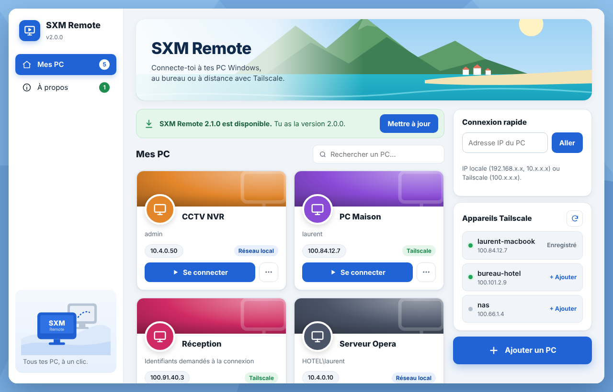

# SXM Remote

Client Bureau à distance (RDP) pour **Fedora** et **macOS**, dans l'esprit de Windows App.
Interface Tauri, moteur de connexion FreeRDP.



## Fonctions
- Tes PC en cartes, connexion en un clic (IP locale ou Tailscale)
- Connexion rapide par IP et liste des appareils Tailscale (en ligne / hors ligne)
- Mots de passe dans le trousseau du système (GNOME Keyring / Trousseau macOS)
- Plein écran, multi-écran, presse-papiers, son, partage de dossier
- Mise à jour intégrée depuis les Releases GitHub

## Installation

Télécharge le fichier de ta plateforme dans la dernière [Release](../../releases/latest).

**Fedora**
```
sudo dnf install ./SXM.Remote-*.x86_64.rpm
```
FreeRDP est installé automatiquement.

**macOS** (11 Big Sur ou plus récent, Intel et Apple Silicon)
1. Ouvre le `.dmg` et glisse **SXM Remote** dans **Applications**.
2. Installe le moteur FreeRDP avec [Homebrew](https://brew.sh) : `brew install freerdp`
3. Au premier lancement : clic droit sur l'appli › **Ouvrir** (l'appli n'est pas signée par Apple).

Raccourci utile : **Ctrl + Alt + Entrée** pour quitter / revenir au plein écran.

## Publier une nouvelle version
Changer `version` dans `src-tauri/tauri.conf.json` (et `Cargo.toml`, `package.json`) puis pousser sur `main` :
l'action GitHub compile le `.rpm` et le `.dmg` et publie la Release. Les applis installées la proposent ensuite d'elles-mêmes.

## Licence
© 2026 Invisible_Dawn — GNU GPL v3 ou ultérieure.
L'ancienne version Python/GTK (1.x) est conservée dans `legacy/`.
